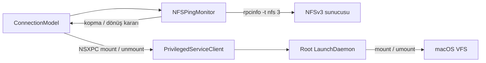

# NFS Ping — Teknik Uygulama Mimarisi

## Amaç

NFS sunucusuna erişim uzun süre kaybolduğunda mevcut mount bağlantısını bir kere ayırmak; sunucu geri geldiğinde mount işlemini otomatik başlatmak. Kontrol, ICMP ping’e değil NFSv3 RPC hizmetinin yanıtına dayanır.

## Önerilen ilk sürüm ayarları

| Ayar | Başlangıç değeri | Açıklama |
| --- | ---: | --- |
| Kontrol aralığı | 30 saniye | Yakın gerçek zaman gerekmediği için düşük sıklık |
| Kopma eşiği | 3 ardışık başarısız kontrol | Kısa ağ dalgalanmalarında ayırmayı önler; kopma yaklaşık 60–90 saniyede anlaşılır |
| Geri dönüş eşiği | 2 ardışık başarılı kontrol | Tek anlık yanıtla yeniden bağlanmayı önler; dönüş yaklaşık 30–60 saniyede anlaşılır |
| RPC zaman aşımı | macOS varsayılanı, en çok 12 saniye | Bir kontrol sürerken yenisi başlatılmaz; süreç timeout sonrasında kapatılır |
| Eşzamanlı probe sayısı | 1 | Süreç birikmesini ve üst üste RPC çağrılarını önler |

Bunlar ilk sürüm için makul varsayılanlardır; daha sonra Ayarlar’a kontrol aralığı eklenebilir. Bu Mac’te `/usr/sbin/rpcinfo` bulunuyor ve yerel man sayfası RPC çağrılarının varsayılan timeout’unu 12 saniye olarak veriyor.

## Probe seçimi

ICMP ping tek başına yeterli değildir: sunucu ICMP’yi engellerken NFS hizmeti çalışabilir; ping yanıt verirken NFS hizmeti durmuş olabilir.

Bağlantı kurulduktan sonra temel sağlık kontrolü:

```sh
/usr/sbin/rpcinfo -t <sunucu> nfs 3
```

Bu, TCP üzerinden NFS programının 3. sürümüne RPC NULL çağrısı yapar. NFSv3, mount işlemi için ayrı MOUNT protokolü de kullanır; bu yüzden mount öncesi/geri dönüş sırasında mount hizmeti de kontrol edilir:

```sh
/usr/sbin/rpcinfo -t <sunucu> mountd 3
```

`rpcinfo` program adı olarak `nfs` ve `mountd` kabul eder. NFSv3 MOUNT servisi program numarası `100005`, sürümü `3` olarak tanımlanır; RPC servis adresleri rpcbind üzerinden bulunur. Sabit TCP 2049 portuna veya yalnızca rpcbind port 111’e bakmak, tek başına servis yanıtını doğrulamaz. [NFSv3 MOUNT protokolü — RFC 1813](https://datatracker.ietf.org/doc/html/rfc1813), [ONC RPC binding — RFC 1833](https://www.rfc-editor.org/rfc/rfc1833.html).

Probe, mevcut `server` alanının `:` öncesindeki host kısmını kullanır. Örneğin `192.168.3.6:/nfs_server` için host `192.168.3.6` olur. Argümanlar shell üzerinden değil `Process.arguments` dizisiyle verilmelidir.

## Bileşenler ve sorumluluklar

- `Sources/NFSPingMonitor.swift` — yeni sınıf. Zamanlayıcıyı, RPC probe süreçlerini, timeout’u ve eşik sayaçlarını yönetir. Root yetkisi kullanmaz.
- `Sources/NFSConnectApp.swift` / `ConnectionModel` — kullanıcı niyetini ve ekranda gösterilecek durumu yönetir; monitörü başlatıp durdurur.
- `Sources/PrivilegedServiceClient.swift` — hazır NSXPC istemcisi üzerinden root helper’a mount/unmount isteği gönderir.
- `Helper/main.swift` — sadece doğrulanmış mount/unmount taleplerini yerine getirir. Ağ izleme mantığı helper’a taşınmaz.



Bu ayrımda ağ erişilebilirliğini kontrol etmek için parola veya root yetkisi gerekmez. Root yetkisi yalnızca mevcut helper’ın sınırlı mount/unmount işlemlerinde kullanılır.

## Durum makinesi

1. **Kapalı / kullanıcı ayırdı**: İzleme ve otomatik yeniden bağlanma niyeti kapalıdır.
2. **Bağlı / izleniyor**: Mount tablosunda hedef NFS mount’ı bulunur; 30 saniyede bir `nfs 3` RPC kontrolü yapılır.
3. **Kopma şüphesi**: Başarısızlık sayacı artırılır. Başarılı probe sayaçları sıfırlar.
4. **Erişim kayıp**: Üç ardışık başarısızlıktan sonra `PrivilegedServiceClient.unmount` bir kez çağrılır. Helper önce normal unmount, gerekirse mevcut force-unmount yolunu dener. Sonraki başarısız probe’larda tekrar tekrar unmount çağrılmaz.
5. **Geri dönüş bekleniyor**: `nfs 3` ve `mountd 3` probe’larının ikisi de başarılı olmalıdır. İki ardışık başarılı turdan sonra tek bir mount isteği gönderilir.
6. **Yeniden bağlanıyor**: Mount isteği sürerken ikinci mount isteği gönderilmez. Başarısız mount, yeni probe turuna kadar tekrar denenmez.

Mount durumu için `rpcinfo` sonucu değil gerçek mount tablosu kullanılır. Probe sunucunun RPC hizmetini, mount tablosu ise yerel dosya sistemindeki bağlantı durumunu gösterir. Sunucu/export erişiminin son doğrulaması yine gerçek mount çağrısıdır.

## Kullanıcı niyetini koruma

- Kullanıcı **Bağlan** dediğinde “bağlı kalma” niyeti etkinleşir ve monitor çalışmaya başlar.
- Monitor sunucu kesintisi sebebiyle mount’ı ayırdığında bu niyet korunur; sunucu dönünce otomatik mount yapılır.
- Kullanıcı **Ayır** dediğinde niyet silinir ve monitor otomatik yeniden bağlanmayı durdurur. Böylece manuel ayırma, sonraki başarılı probe’da geri alınmaz.
- İstenirse niyet `UserDefaults` içinde tutulup uygulama girişte çalıştığında okunabilir. Uygulama açık kalmalı: kırmızı pencere düğmesi uygulamayı gizlediği için monitor çalışmaya devam eder; menüdeki **Çıkış** uygulamayı tamamen kapatır ve izlemeyi durdurur. Launch at login açıksa uygulama bir sonraki girişte tekrar başlayabilir.

## Hata ve kaynak yönetimi

- Her anda yalnızca bir `rpcinfo` süreci çalışır. Bir probe sürerken zamanlayıcı tick’i gelirse ikinci probe başlatılmaz.
- Süreç `Process` ile başlatılır; shell kullanılmaz. Timeout olursa süreç sonlandırılır, stdout/stderr okunup kapatılır ve sonuç başarısız probe sayılır.
- Uygulama uykuya girip uyandığında kaçırılmış tick’ler için peş peşe probe çalıştırılmaz; tek bir yeni probe başlatılır.
- RPC başarısızlığı kullanıcıya “sunucu erişilemiyor” durumu olarak gösterilir. Helper/XPC hatası ayrı hata olarak gösterilir; ikisi aynı durum değildir.
- Force unmount açık dosya işlemlerini etkileyebilir. Otomatik force unmount yalnızca üç başarısız probe sonrasında ve daha önce kullanıcı tarafından kurulmuş mount için çalışmalıdır.

## Uygulama sırası

1. `NFSPingMonitor` sınıfı ve durum enum’unu ekle.
2. `ConnectionModel` içinde kullanıcı niyeti, mevcut mount durumu ve monitor durumunu birleştir.
3. **Bağlan** ile izlemeyi başlat; **Ayır** ile niyeti temizleyip izlemeyi durdur.
4. Kopma eşiğinde mevcut XPC unmount çağrısını, dönüş eşiğinde mevcut XPC mount çağrısını kullan.
5. Tray simgesi ve ana pencere durumunu gerçek mount tablosuna göre güncelle; probe sonucunu ayrı bir bağlantı durumu mesajı olarak göster.
6. Geliştirme sırasında şu senaryoları doğrula: sunucu erişilebilir, ICMP kapalı ama NFS açık, NFS/RPC kapalı, kısa kesinti, kalıcı kesinti ve geri dönüş, manuel ayırma, uygulama yeniden başlatma, mount isteği başarısızlığı.

## Açık kararlar

- “Bağlı kalma” niyeti uygulama yeniden başlatmasında saklansın mı? Bu notun önerisi `UserDefaults` ile saklamak ve manuel **Ayır** ile silmektir.
- İlk sürümde 30 saniye / 3 başarısız / 2 başarılı sabit varsayılan olsun; sonradan kullanıcı ayarı eklenebilir.
- İzleme yalnızca menü çubuğu uygulaması çalışırken sürer. Uygulama **Çıkış** yapıldığında da izleme istenirse monitor’ın LaunchDaemon’a taşınması ayrı bir mimari karar olarak ele alınmalı; ilk sürümde root helper’ın kapsamı genişletilmemelidir.
